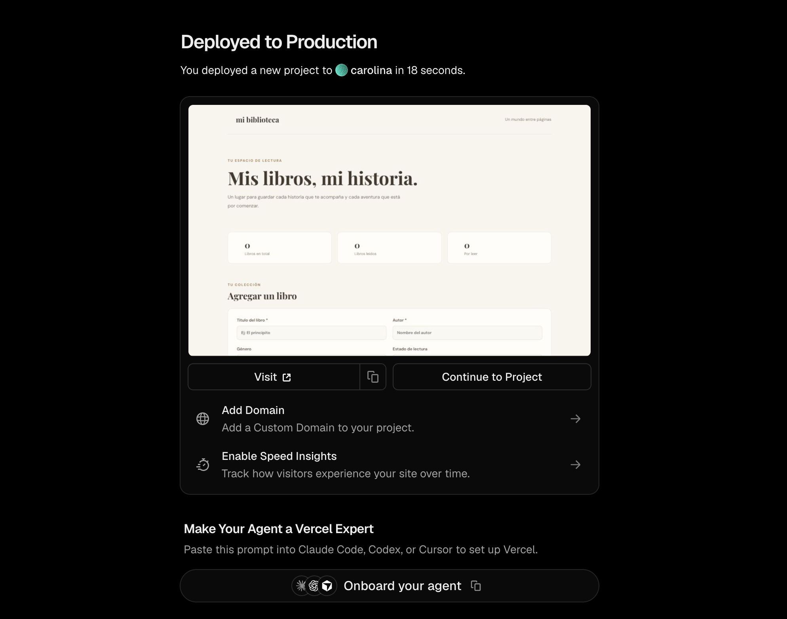
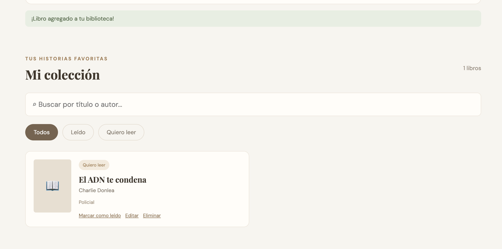
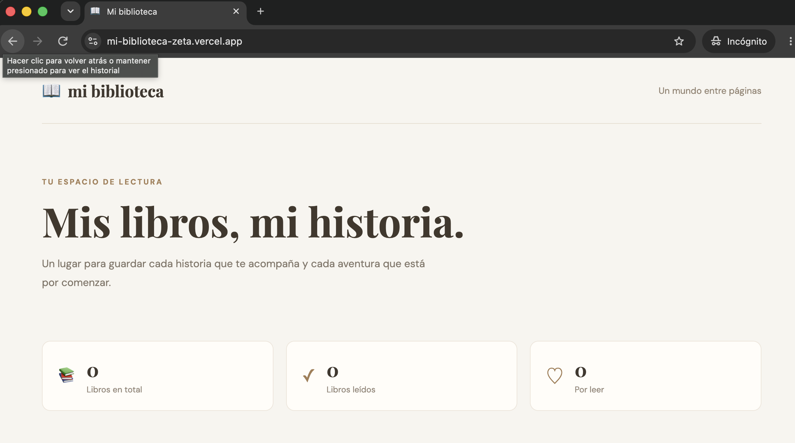
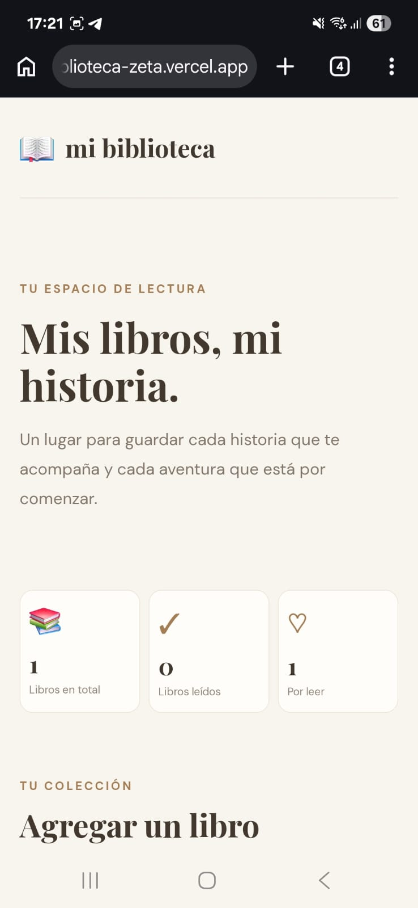
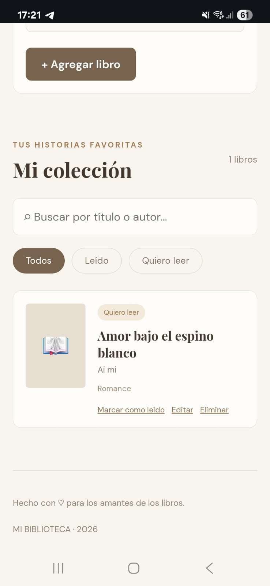
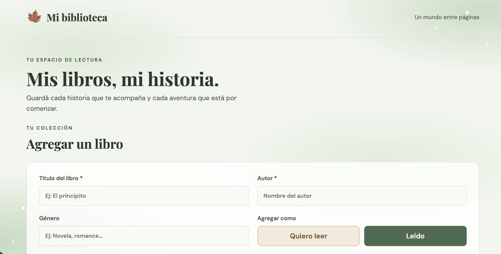
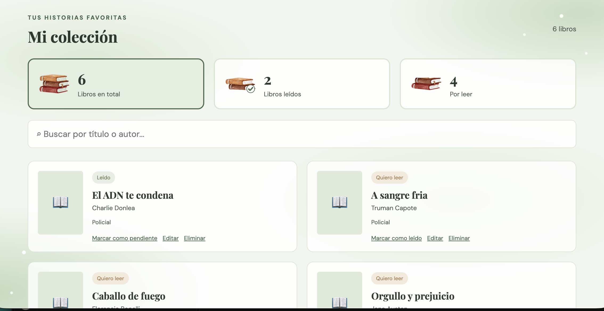
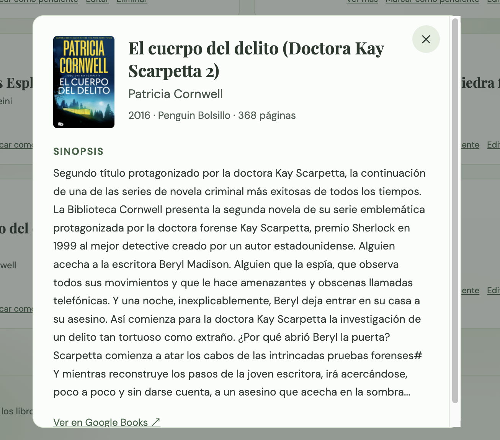
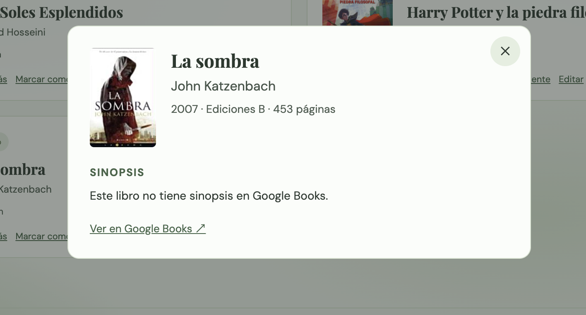
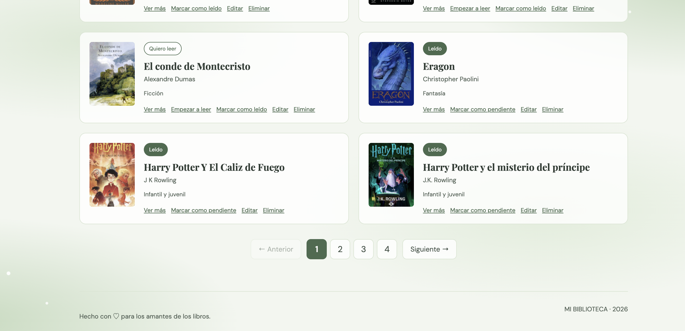

# Bitácora – Mi biblioteca

## Idea inicial

- **Qué es:** una biblioteca personal para registrar libros leídos y pendientes.
- **Necesidad:** muchas veces encontramos un libro que nos interesa (por la recomendación de un conocido, un video o una reseña) y después nos olvidamos de cuál era. La app permite guardarlo para leerlo más adelante y, además, llevar la lista de los libros ya leídos.
- **Público:** personas a las que les gusta leer.
- **Información guardada:** título, autor, género, estado de lectura y el usuario dueño de cada libro.

---

## Versión 1 – Primera versión funcional (commit "version1")

**Qué se hizo**
- Proyecto creado con React + Vite.
- Interfaz con formulario, estadísticas, buscador, filtros y tarjetas de libros.
- Conexión con Firestore: agregar, consultar, modificar y eliminar libros.

**Diseño:** quería algo sobrio y simple, que transmitiera orden y donde la información fuera fácil de encontrar. Por eso elegí tarjetas para cada libro (me resultan más fáciles de leer), colores cálidos beige y marrón, la tipografía Playfair Display (con serifa) para los títulos y DM Sans para el resto. Me inspiré en Goodreads, una app que uso, pero sin tantas pestañas ni secciones que no hacen falta: la idea era que todo estuviera organizado y fuera fácil de usar.

**Uso de IA:** usé ChatGPT y Claude para que me guiaran en los pasos del proyecto. El pedido inicial fue, aproximadamente: "quiero hacer una app de libros, para llevar la cuenta de los libros, para personas a las que les gusta leer".

**Pruebas:** agregaba libros, los editaba y les cambiaba el estado, y me fijaba en Firebase (Firestore → Datos) que aparecieran y se actualizaran.

**Dificultades:** con los usuarios anónimos, cada vez que entraba se creaba un usuario nuevo, pero todos veían los mismos libros. Me costó encontrar el problema y hubo que hacer muchos cambios. Con ayuda de Claude se resolvió en la versión 2: cada libro guarda el usuario dueño (`ownerId`), la app solo consulta los libros de ese usuario y las reglas de Firestore lo exigen.

**Capturas:** no guardé capturas de esta versión. El código de la versión 1 se puede ver en el historial de GitHub, en el commit "version1".

---

## Versión 2 – Mejoras

**Qué cambió**
- Inicio de sesión anónimo: cada navegador tiene su propia biblioteca.
- Se guarda el `ownerId` en cada libro y solo se consultan los libros del usuario.
- Reglas de Firestore (`firestore.rules`): cada usuario solo accede a sus libros y se validan los campos.
- Indicador "Cargando tu biblioteca..." y mensaje distinto cuando la búsqueda no encuentra nada.
- Mensajes de éxito en verde y de error en rojo.
- El botón muestra "Guardando..." mientras se guarda.
- El código se separó en componentes (`Estadisticas`, `FormularioLibro`, `TarjetaLibro`) y un archivo con las operaciones de Firestore (`librosService.js`).
- Se borró código que no se usaba (registro con email, datos de prueba, imágenes de la plantilla).
- README con instrucciones.

**Dificultad encontrada:** al filtrar por `ownerId`, los libros nuevos no aparecían porque al agregarlos no se guardaba ese campo. Se resolvió agregando `ownerId` en `addDoc`.

**Pruebas**
- [x] Agregar un libro desde la URL publicada: aparece el mensaje "¡Libro agregado a tu biblioteca!" y el libro en la lista.
- [x] Recargar la página y comprobar que el libro sigue.
- [x] Marcarlo como leído y editarlo.
- [x] Eliminarlo.
- [x] Abrir la URL en una ventana de incógnito: la biblioteca aparece vacía, sin los libros de la otra ventana. Cada navegador tiene su propio usuario anónimo.
- [x] Probar en el celular: se agregó un libro y la app se ve y se usa bien en pantalla chica. Al volver a abrir el link en el celular, el libro sigue ahí (el celular conserva su propio usuario anónimo).

**Verificación en Vercel:** el proyecto se importó desde GitHub en Vercel, con las 4 variables `VITE_FIREBASE_*` cargadas. El despliegue terminó en "Deployed to Production" (18 segundos). En https://mi-biblioteca-zeta.vercel.app/ se probó agregar un libro, recargar, marcarlo como leído, editarlo y eliminarlo, y todo funcionó.

**Dificultades al publicar:** al crear la cuenta de Vercel se usó Gmail en lugar de GitHub, así que hubo que autorizar la app de Vercel en GitHub e instalarla solo para el repositorio mi-biblioteca. La ventana de autorización de GitHub se abrió detrás del navegador y parecía que Vercel estaba trabado; se resolvió encontrando esa ventana.

**Capturas:**

Despliegue en Vercel terminado ("Deployed to Production"):

App publicada con un libro agregado y el mensaje de éxito:

Ventana de incógnito: la biblioteca aparece vacía, porque es otro usuario:

En el celular:

---

## Versión 3 – Versión final

**Qué cambió**

*Diseño*
- Nueva paleta en **verde acuarela**, en lugar de beige y marrón. Me inspiré en una imagen de fondo de acuarela verde que encontré. El fondo se hizo con CSS (manchas verdes suaves con degradados y puntitos blancos), sin usar la imagen, para que el diseño sea propio y la página cargue más rápido.
- Las imágenes de inspiración las saqué de Pinterest. En un primer momento pensé en un fondo con flores, pero lo descarté: las flores llamaban mucho la atención y la página se iba a ver más recargada y menos "de libros". La acuarela verde mantiene la idea de algo sobrio y tranquilo.
- Los colores quedaron ordenados en **variables CSS** (`--principal`, `--fondo`, `--texto`, etc.) al principio de `App.css`.
- Las tarjetas son un poco transparentes, así se ve la acuarela por detrás.
- **Logo:** una **hoja** de otoño reemplaza el ícono de libro, y el nombre pasó a ser "Mi biblioteca", con M mayúscula. La hoja también es el ícono de la pestaña del navegador (favicon).
- **Íconos de acuarela** para los contadores: una pila de 3 libros (total), 2 libros con un tilde verde (leídos) y 2 libros con un marcador (por leer). Salen de una misma ilustración de libros en acuarela, para que los tres tengan la misma estética. Se les sacó el fondo blanco para que se integren con el fondo verde.
- Los tonos cálidos de los libros y la hoja contrastan con el verde, como un libro sobre el pasto en otoño.

*Funciones y experiencia de uso*
- **"Agregar un libro" es lo primero que se ve:** se achicó la presentación de arriba.
- **Agregar en un solo paso:** se sacaron el desplegable de estado y el botón "Agregar libro". Ahora hay dos botones, **Quiero leer** y **Leído**, que guardan el libro directamente con ese estado. Tienen los mismos colores que las etiquetas de estado de las tarjetas.
- **Los contadores se movieron a "Mi colección" y ahora son botones:** al tocar "Libros en total", "Libros leídos" o "Por leer", la lista muestra solo esos libros. Por eso se sacaron los botones de filtro "Todos / Leído / Quiero leer", que hacían lo mismo.
- En el celular los contadores son más compactos (ícono arriba, número y texto abajo).
- Se corrigió "1 libros" → "1 libro".

**Por qué:** quería que agregar un libro llevara menos pasos y que la página fuera más ordenada, sin elementos repetidos. El cambio de colores le da una identidad propia, más tranquila, que acompaña la idea de un espacio de lectura.

**Uso de IA:** usé Claude para aplicar los cambios. Le mandé las imágenes de inspiración (el fondo de acuarela, la ilustración de libros y la hoja) y le expliqué lo que quería en cada paso. Por ejemplo: *"Quiero sacar el botón de agregar el libro y que en la parte de estado de lectura estén dos botones, uno de 'Quiero leer' y otro de 'Leído', para que no se hagan tantos pasos."* Revisé cada cambio en mi compu con `npm run dev` antes de subirlo.

**Pruebas:** primero revisé cada cambio en mi compu con `npm run dev` (localhost). Después, en la URL publicada, agregué varios libros con los botones "Quiero leer" y "Leído", y comprobé que los contadores de "Mi colección" filtraran bien la lista.

**Verificación en Vercel:** subí los cambios a GitHub (commit "version3") y Vercel hizo un despliegue nuevo automáticamente. Al abrir https://mi-biblioteca-zeta.vercel.app/ ya se veía el diseño verde con la hoja, y agregar libros funcionó. **Dificultad:** al principio me confundí entre el link de localhost (la app corriendo solo en mi compu, para probar) y el de Vercel (la app publicada, que es la que se entrega).

**Capturas:**

"Agregar un libro" como primera sección, con los botones "Quiero leer" y "Leído":

"Mi colección" con los contadores como filtros ("Libros en total" seleccionado):

---

## Versión 4 – API de libros (Google Books)

**Por qué:** en la corrección, el profesor me pidió sumar una API de libros, en lo posible en español.

**Qué se agregó**
- **Buscador al escribir el título:** mientras se escribe, la app busca en **Google Books** y muestra una lista de libros con su portada. Al elegir uno, se completan solos el título, el autor y el género. Así se escribe menos y hay menos pasos.
- **Portadas reales:** si el libro se eligió de la lista, la tarjeta muestra su tapa. Si se cargó a mano, sigue apareciendo el ícono 📖.
- **"Ver más":** en los libros que vienen de Google Books, un botón abre una ventana con la sinopsis, el año, la editorial y la cantidad de páginas. Estos datos se piden a la API en el momento.
- Toda la comunicación con la API está en `src/googleBooks.js` y usa `fetch`. La respuesta llega en formato JSON. Mientras busca se muestra "Buscando...", y si algo falla aparece un mensaje y se puede completar el libro a mano.
- **Reglas de Firestore actualizadas:** aceptan los dos campos nuevos (`portada` y `googleId`), validan que la portada sea una dirección `https://` y no permiten agregar otros campos.

**Elección de la API**
- Antes de programar hice una **prueba mínima** desde la app publicada. **Google Books sin clave** respondió *"Quota exceeded"* (error 429): sin clave propia se comparte un cupo diario con todos los usuarios, y ya estaba agotado.
- **Open Library** sí respondió sin clave, pero algunos libros venían con el título en inglés ("In Cold Blood" en lugar de "A sangre fría") y casi sin sinopsis.
- Elegí **Google Books con una clave propia (API key)**. Es gratis, tiene un cupo de 1000 búsquedas por día para la app y no requiere tarjeta. La creé en Google Cloud dentro del mismo proyecto de Firebase, con dos restricciones de seguridad:
  - solo sirve para la **Books API**;
  - solo funciona desde mi página de Vercel y desde mi compu (`localhost`).
- La clave se guarda en `.env` como `VITE_GOOGLE_BOOKS_API_KEY` (no se sube a GitHub) y se cargó también en las variables de entorno de Vercel.

**Dificultad: los resultados de la búsqueda**
- **Problema:** al escribir una palabra a medias, aparecían resultados que no tenían nada que ver. Por ejemplo, con "el princi" aparecían libros antiguos escaneados del siglo XVIII. Y con *Los siete maridos de Evelyn Hugo*, al borrar la última letra ("Hug") la lista empeoraba y el libro correcto dejaba de aparecer arriba.
- **Causa:** Google Books busca **palabras completas**, así que "princi" o "hug" no las reconoce como el comienzo de "principito" o "Hugo". Además, al principio la lista mostraba **primero los libros con portada**, y eso mandaba al fondo al libro correcto cuando no tenía tapa.
- **Solución:**
  - Se limpian los resultados: se sacan los que no tienen autor, los repetidos y los publicados antes de 1900 (suelen ser documentos antiguos escaneados).
  - Se ordena la lista según **cuánto se parece el título a lo escrito**. Para la última palabra, que puede estar a medio escribir, alcanza con que una palabra del título empiece con ella ("hug" cuenta para "Hugo"). La portada solo se usa para desempatar.
  - La búsqueda espera a que se deje de escribir un momento antes de consultar la API (así se gastan menos búsquedas del cupo).
  - El texto de ayuda del campo dice *"Escribí el título y elegí tu libro"*. Si no hay resultados, aparece: *"No encontramos ese libro. Probá con el título completo o completalo a mano."*
- **Libros con títulos muy parecidos:** al buscar *La sombra* de John Katzenbach o *El cuerpo del delito* de Patricia Cornwell, la lista se llenaba de otros libros con títulos parecidos y el que buscaba no aparecía. **Solución:** ahora el campo **Autor** también se usa para buscar. Si se escribe el autor (al menos 3 letras), la app le pide a Google que el autor coincida (`inauthor:`). Así, "La sombra" + "katzenbach" encuentra el libro enseguida. Si con ese autor no aparece nada (por ejemplo, porque está mal escrito), se busca solo por título. Al final de la lista se agregó la ayuda *"¿No está tu libro? Escribí también el autor"*.
- **Géneros en español:** Google Books devuelve los géneros en inglés ("Fiction", "True Crime", "Biography & Autobiography"). Se agregó una lista de traducciones en `src/googleBooks.js` (por ejemplo, "Fiction" → "Ficción", "True Crime" → "Crimen real"). Si el género viene como "Fiction / Romance / General", se usa la parte más específica ("Romance"). Si un género no está en la lista, el campo queda vacío para escribirlo a mano. Además, muchas ediciones vienen **sin género** en la búsqueda. En ese caso, al elegir el libro la app pide el detalle a la API, que suele traer géneros más completos. Si Google directamente no tiene el género cargado para esa edición, el campo queda vacío. Esto depende de los datos de Google: por ejemplo, una edición de *A sangre fría* figura como "Drama".
- **Limitación que queda:** con una sola palabra a medio escribir (por ejemplo "el princi") Google Books no encuentra el libro, porque no completa palabras sueltas. Escribiendo la palabra completa funciona bien, y siempre se puede cargar el libro a mano.

**Ajuste de mensajes:** al eliminar un libro desde "Mi colección", el aviso aparecía arriba, junto al formulario, lejos de donde se hizo la acción. Ahora los mensajes de las acciones de la colección (eliminar y cambiar el estado) aparecen **abajo, en "Mi colección"**, y desaparecen solos a los 4 segundos. El aviso de eliminado se muestra **en rojo** e incluye el nombre del libro, para que se note qué se borró. Los mensajes de agregar y editar siguen arriba, junto al formulario.

**Uso de IA:** usé Claude para comparar las APIs, crear la clave paso a paso y programar las funciones. Le pedí, por ejemplo: *"El profesor me pidió usar una API sobre libros. ¿Cómo puedo llegar a usar una API? ¿Qué funciones podríamos sumar?"*. Elegí las tres ideas propuestas (buscador, portadas y "Ver más"). También le marqué el problema de la búsqueda al borrar letras, y lo corregimos juntas.

**Pruebas:** primero probé en mi compu (localhost) buscando distintos libros: *El principito*, *A sangre fría*, *Los siete maridos de Evelyn Hugo* (también borrando letras al final), *La sombra* de John Katzenbach y *El cuerpo del delito* de Patricia Cornwell (usando también el autor). Comprobé que se completaran el autor, el género y la portada, que la portada apareciera en la tarjeta y que "Ver más" mostrara la sinopsis. También probé un libro cuya edición no tiene sinopsis en Google Books, y la app lo avisa sin romperse.

**Verificación en Vercel:** publiqué las reglas nuevas en Firebase, cargué la clave en las variables de entorno de Vercel (`VITE_GOOGLE_BOOKS_API_KEY`, tipo Config; Vercel avisa que una variable con `VITE_` queda visible en el navegador, y la marqué como segura porque la clave tiene restricciones) y subí los cambios con el commit "version4". En https://mi-biblioteca-zeta.vercel.app/ el buscador, las portadas y "Ver más" funcionaron igual que en mi compu.

**Capturas:**

"Ver más" de *El cuerpo del delito* (Patricia Cornwell), con la portada, los datos y la sinopsis que trae la API:

"Ver más" de *La sombra* (John Katzenbach): esa edición no tiene sinopsis en Google Books, y la app lo avisa en lugar de mostrar un error:

---

## Versión 5 – Paginación de la colección

**Por qué:** después de cargar 11 o 12 libros, la página se hacía cada vez más larga y había que bajar mucho para llegar al final de la colección. Con el uso real de la app la lista iba a seguir creciendo.

**Qué cambió**
- **"Mi colección" muestra de a 6 libros por página**, con los botones **← Anterior**, los **números de página** y **Siguiente →**. Si hay 6 libros o menos, los botones no aparecen.
- **La paginación respeta el filtro y la búsqueda:** si se toca "Libros leídos" o "Por leer", o se escribe en el buscador, las páginas se arman solo con esos libros, y la vista vuelve a la página 1.
- **Los libros se ordenan alfabéticamente por título**, así cada libro queda siempre en la misma página y es más fácil encontrarlo.
- Al cambiar de página, la vista sube al principio de "Mi colección".
- Si se elimina el último libro de la última página, la app pasa sola a la página anterior en lugar de quedar en una página vacía.
- **Diseño:** la página que se está viendo queda marcada en verde, igual que el contador elegido, para que se entienda que funcionan de la misma manera. En el celular, los números quedan arriba y "Anterior" y "Siguiente" abajo, a los costados, para que se puedan tocar con el dedo.
- El código de los botones quedó en un componente nuevo, `src/components/Paginacion.jsx`; la lógica (qué libros van en cada página) está en `src/App.jsx`. No hizo falta cambiar Firestore ni las reglas: la paginación se hace en el navegador con los libros que ya se consultan.

**Uso de IA:** le pedí a Claude: *"Ahora sumé varios libros, pero la hoja se sigue haciendo cada vez más larga. ¿Es posible hacer varias páginas de los libros? Que muestre de a 6 libros por cada filtro."* Claude programó la paginación y la probó con 12 libros de prueba: 6 por página, cambio de filtro y búsqueda, eliminación en la última página y vista en celular.

**Pruebas**
- [ ] En mi compu (`npm run dev`), con mis libros cargados: aparecen las páginas de a 6 y los botones funcionan.
- [ ] Los contadores ("Libros en total", "Libros leídos", "Por leer") y el buscador muestran las páginas correctas.
- [ ] En la URL de Vercel, después del commit "version5", la paginación funciona igual.
- [ ] En el celular, los botones se ven y se pueden tocar bien.

**Video:** además, al mini video le sumé una sección al principio, "Así era el diseño anterior", con capturas que había tomado de la versión beige y marrón (versiones 1 y 2), en computadora y celular, para que se vea la evolución del diseño.

**Capturas:**

<!-- Agregar una captura de la colección con los botones de página, por ejemplo: -->
<!--  -->
